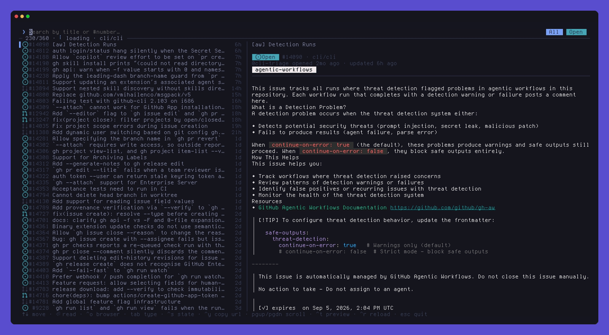
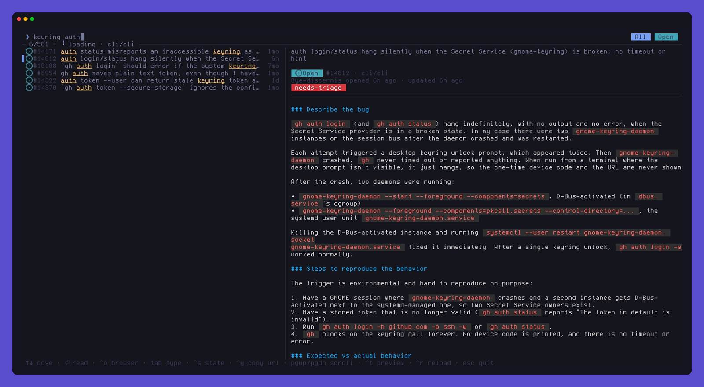
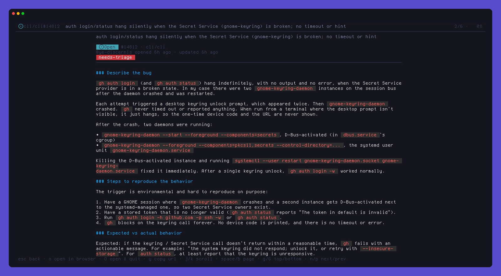
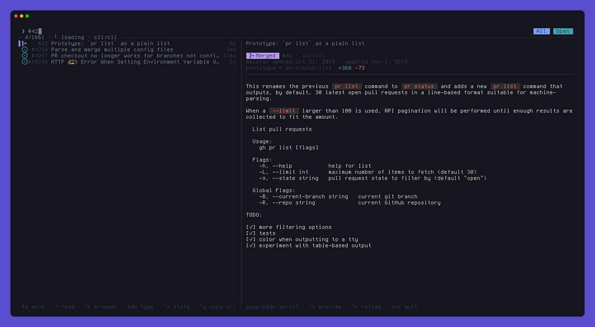
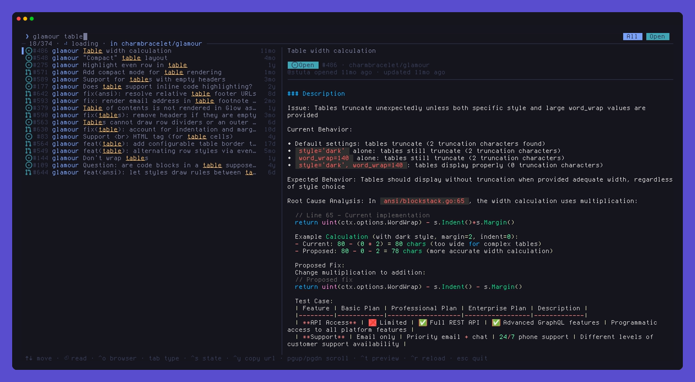
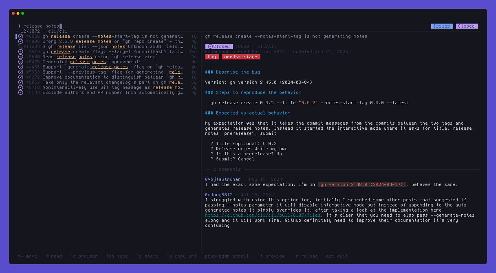

<div align="center">

# ghspot

**Spotlight for your GitHub issues and pull requests.**

Fuzzy-find any ticket by title or number, read it right in your terminal,<br>
and open it in the browser only when you actually want to.

[](https://go.dev)
[](LICENSE)
[](https://github.com/charmbracelet/bubbletea)



</div>

---

## Why

`gh issue list | grep` gets old fast, and the GitHub web search is a context
switch. **ghspot** loads your repo's tickets in the background and filters them
as fast as you can type, the same way Spotlight or Raycast does. Results show
up instantly, previews render as proper Markdown, and the browser stays shut
until you ask for it.

## Features

- ⚡ **Instant fuzzy search.** Type words in any order, with typos. Literal and
  word-start matches rank first, and matched letters are highlighted.
- 🔢 **Jump by number.** `123` or `#123` puts that ticket on top. If it isn't
  cached yet, it's fetched straight from GitHub.
- 🗂 **Scope to a repo with one word.** When searching across repos, start with
  part of a repo name: `glamour table`, `api 512`, or just `api`.
- 📖 **Read in the app.** A live side preview, plus a full-screen reader with
  rendered Markdown, labels, PR branches and diff stats, review state and comments.
- 🌐 **Browser on demand.** `ctrl+o` from the list or `o` in the reader. Nothing
  opens unless you ask.
- 🎛 **Filters.** `tab` cycles All / Issues / PRs and `ctrl+s` cycles
  Open / Closed / Any.
- 🔭 **Not limited to the cache.** Open and closed tickets load in parallel, and
  every query also searches GitHub in the background, so old tickets still turn up.
- 🔐 **No extra setup.** Authentication reuses your existing `gh` login.

## Screenshots

<table>
<tr>
<td width="50%"><p align="center"><sub><b>Fuzzy search with live preview</b></sub></p></td>
<td width="50%"><p align="center"><sub><b>Full-screen reader</b></sub></p></td>
</tr>
<tr>
<td width="50%"><p align="center"><sub><b>Jump to <code>#42</code>, fetched from GitHub on demand</b></sub></p></td>
<td width="50%"><p align="center"><sub><b><code>glamour table</code>, scoped to one repo in an org</b></sub></p></td>
</tr>
<tr>
<td colspan="2"><p align="center"><sub><b>Closed issues only, with comments in the preview</b></sub></p></td>
</tr>
</table>

## Install

You need the [GitHub CLI](https://cli.github.com) logged in (`gh auth login`).

```sh
curl -fsSL https://raw.githubusercontent.com/jaderfeijo/ghspot/main/install.sh | bash
```

(builds it with Go into `~/.local/bin`; `... | bash -s -- --uninstall` removes it), or with Go directly:

```sh
go install github.com/jaderfeijo/ghspot@latest
```

Or build from source:

```sh
git clone https://github.com/jaderfeijo/ghspot && cd ghspot
go build -o ~/.local/bin/ghspot .
```

> [!TIP]
> Status icons use [Nerd Font](https://www.nerdfonts.com) glyphs. No Nerd Font?
> Run with `--no-icons`.

## Usage

```sh
ghspot                    # the repo you're in (or everything involving you, outside a repo)
ghspot -R cli/cli         # any repo
ghspot --org charmbracelet  # every repo in an org
ghspot --mine             # everything involving you, across GitHub
ghspot -1 flaky test      # start with a query; quit after opening in the browser
```

### Search

| You type | You get |
| --- | --- |
| `login bug` | titles containing both words, in any order, typos allowed |
| `#512` or `512` | ticket 512 first, then numbers starting with 512 |
| `api 512` | ticket 512 in the repo whose name starts with `api` *(multi-repo scopes)* |
| `api timeout` | titles matching `timeout`, only in that repo |

### Keys

**List**

| Key | Action |
| --- | --- |
| `↑` `↓` · `ctrl+p` `ctrl+n` | move (`ctrl+b` / `ctrl+f` page) |
| `enter` | read the ticket full-screen |
| `ctrl+o` | open in browser (`alt+enter`: open and quit) |
| `tab` | All → Issues → PRs |
| `ctrl+s` · `shift+tab` | Open → Closed → Any state |
| `ctrl+y` | copy URL |
| `pgup` `pgdn` · `shift+↑↓` · mouse wheel | scroll preview |
| `ctrl+t` | toggle preview |
| `ctrl+r` | reload |
| `esc` | clear the query, then quit |

**Reader**

| Key | Action |
| --- | --- |
| `esc` · `q` | back to the list |
| `o` | open in browser (`O`: open and quit) |
| `y` | copy URL |
| `j` `k` · `space` `b` · `g` `G` | scroll, page, top / bottom |
| `n` `p` | next / previous result |

The browser is `$BROWSER` if set, otherwise `xdg-open`.

## Tip: bind it to a hotkey

ghspot works well as a launcher: a hotkey opens a floating terminal, you find
the ticket, and `alt+enter` opens it and closes the window. With Hyprland, for example:

```ini
bind = SUPER, G, exec, foot --app-id=ghspot -e ghspot -1 -R your/repo
windowrule = float, class:^(ghspot)$
windowrule = size 70% 70%, class:^(ghspot)$
```

## How it works

- Tickets come from GitHub's GraphQL search API through
  [go-gh](https://github.com/cli/go-gh), with the token from `gh`. ghspot never
  stores credentials.
- On start it pages through the 1,000 most recently updated open tickets and the
  1,000 most recent closed ones, newest first, while you're already typing.
- Each query is matched locally, so results appear instantly. After a short pause
  ghspot also asks GitHub, merges in whatever wasn't cached, and looks up unknown
  numbers directly.
- Built with [Bubble Tea](https://github.com/charmbracelet/bubbletea),
  [Lip Gloss](https://github.com/charmbracelet/lipgloss) and
  [Glamour](https://github.com/charmbracelet/glamour).

The demo is recorded with [VHS](https://github.com/charmbracelet/vhs). Run
`vhs demo.tape` to regenerate it.

## License

[MIT](LICENSE) © Jader Feijo
